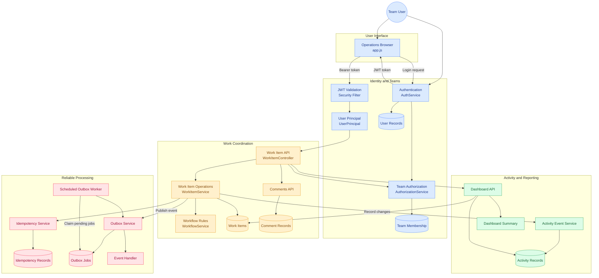

# Newtonite Ops — Operations Under Pressure

A production-oriented operations management platform designed to help engineering, payment, risk, and customer support teams manage incidents, coordinate tasks, and handle approvals securely.

The system focuses on reliable workflows, team-based authorization, concurrency control, and consistent database operations.

## Key Features

- **Work Item Management:** Create, assign, claim, update, and resolve operational items.
- **Role-Based Authorization:** Control access using user roles and team memberships.
- **Concurrency Control:** Atomic claiming and optimistic locking help prevent conflicting updates.
- **Idempotency:** Prevent duplicate work items when equivalent requests are retried.
- **Activity History:** Maintain an append-only record of important changes.
- **Dashboard:** Access operational summaries and team-specific work items.
- **Transactional Outbox:** Process background events with retry support.
- **Secure Authentication:** JWT-based authentication and BCrypt password hashing.

## Technology Stack

| Technology | Purpose |
|---|---|
| Java 21 | Backend development |
| Spring Boot 3 | Application framework |
| Spring Security and JWT | Authentication and access control |
| Spring Data JPA / Hibernate | Data persistence |
| PostgreSQL | Relational database |
| Flyway | Database migrations |
| HTML, CSS, JavaScript | Frontend interface |
| Maven | Build and dependency management |
| Docker Compose | Database environment |

## System Architecture

The following diagram illustrates how the user interface, security layer, work coordination services, database, activity tracking, and background processing interact.



## API Highlights

| Method | Endpoint | Description |
|---|---|---|
| `POST` | `/api/auth/login` | Authenticate a user |
| `GET` | `/api/teams` | List accessible teams |
| `GET` | `/api/items` | Retrieve work items |
| `POST` | `/api/items` | Create a work item |
| `POST` | `/api/items/{id}/claim` | Claim an item |
| `POST` | `/api/items/{id}/assign` | Assign an item |
| `GET` | `/api/dashboard/summary` | Retrieve dashboard metrics |

## Getting Started

### Prerequisites

- JDK 21
- Git
- Docker with Docker Compose

### 1. Clone the Repository

```bash
git clone https://github.com/prabhkalraa/newtonite-ops-23131180344.git
cd newtonite-ops-23131180344
```

### 2. Start PostgreSQL

```bash
docker compose up -d postgres
```

### 3. Build the Project

```bash
chmod +x mvnw
./mvnw clean package
```

### 4. Run the Application

```bash
./mvnw spring-boot:run
```

Open `http://localhost:8080` in your browser.

### 5. Run Tests

```bash
./mvnw test
```

## Reliability and Security

Newtonite Ops combines JWT authentication, team-level permission checks, database transactions, optimistic locking, and idempotency handling. Its transactional outbox separates event persistence from background processing, while activity records provide an audit trail of operational changes.

Review `ENGINEERING_DECISIONS.md` and `KNOWN_LIMITATIONS.md` for additional architectural details and documented limitations.

## Future Improvements

- Expanded integration and concurrency testing
- Enhanced dashboard reporting
- Improved monitoring and observability
- Deployment automation

---

**Newtonite Ops** — Reliable workflows, secure collaboration, and consistent operations.
