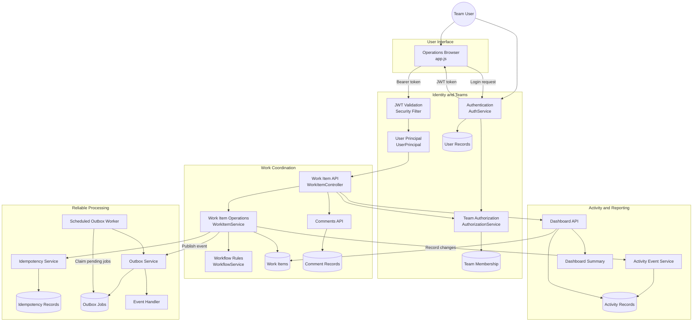

# Newtonite Ops — Operations Under Pressure

A production-oriented operations management platform designed to help engineering, payment, risk, and customer support teams manage incidents, coordinate tasks, and handle approvals securely.

The system focuses on reliable workflows, team-based authorization, concurrency control, and consistent database operations.

## Key Features

- **Work Item Management:** Create, assign, claim, update, and resolve operational items.
- **Role-Based Authorization:** Control access using user roles and team memberships.
- **Concurrency Control:** Atomic claiming and optimistic locking help prevent conflicting updates.
- **Idempotency:** Prevent duplicate work items when equivalent requests are retried.
- **Activity History:** Maintain an append-only record of important changes.
- **Dashboard:** Access operational summaries and team-specific work items.
- **Transactional Outbox:** Process background events with retry support.
- **Secure Authentication:** JWT-based authentication and BCrypt password hashing.

## Technology Stack

| Technology | Purpose |
|---|---|
| Java 21 | Backend development |
| Spring Boot 3 | Application framework |
| Spring Security and JWT | Authentication and access control |
| Spring Data JPA / Hibernate | Data persistence |
| PostgreSQL | Relational database |
| Flyway | Database migrations |
| HTML, CSS, JavaScript | Frontend interface |
| Maven | Build and dependency management |
| Docker Compose | Database environment |

## System Architecture

The following diagram illustrates how the user interface, security layer, work coordination services, database, activity tracking, and background processing interact.



## Demo Credentials & User Roles

The database is pre-seeded deterministically with 10 demo users across 4 teams.


| Username | Role | Primary Team Access | Password |
|---|---|---|---|
| `admin_alice` | ADMIN | Core Infrastructure, Payment Services | `Password123!` |
| `lead_bob` | LEAD | Core Infrastructure, Customer Support | `Password123!` |
| `member_charlie` | MEMBER | Core Infrastructure | `Password123!` |
| `viewer_diana` | VIEWER | Core Infrastructure | `Password123!` |
| `lead_elena` | LEAD | Payment Services | `Password123!` |
| `member_frank` | MEMBER | Payment Services | `Password123!` |
| `lead_grace` | LEAD | Compliance & Risk | `Password123!` |
| `member_harry` | MEMBER | Compliance & Risk | `Password123!` |
| `viewer_iris` | VIEWER | Compliance & Risk | `Password123!` |
| `member_jack` | MEMBER | Customer Support | `Password123!` |

**Demo password for all listed users:** `Password123!`

> **Security note:** These are demo credentials intended for local development and testing only. Do not use default demo passwords in production or expose a publicly deployed instance with these credentials.

## API Highlights

| Method | Endpoint | Description |
|---|---|---|
| `POST` | `/api/auth/login` | Authenticate a user |
| `GET` | `/api/teams` | List accessible teams |
| `GET` | `/api/items` | Retrieve work items |
| `POST` | `/api/items` | Create a work item |
| `POST` | `/api/items/{id}/claim` | Claim an item |
| `POST` | `/api/items/{id}/assign` | Assign an item |
| `GET` | `/api/dashboard/summary` | Retrieve dashboard metrics |

## Getting Started

### Prerequisites

- JDK 21
- Git
- Docker Desktop with Docker Compose
- A terminal such as macOS Terminal or VS Code's integrated terminal

### 1. Install Java

Install JDK 21 from [Eclipse Temurin](https://adoptium.net/temurin/releases/?version=21).

Choose the correct download for your Mac:

- **Apple Silicon Mac:** macOS ARM64
- **Intel Mac:** macOS x64

A VS Code Java extension alone is not enough; the JDK must be installed on your system.

Verify the installation:

```bash
java -version
javac -version
```

### 2. Install and Start Docker Desktop

Install [Docker Desktop](https://www.docker.com/products/docker-desktop/) and open it. Wait until Docker is running.

Verify Docker and Compose:

```bash
docker --version
docker compose version
```

### 3. Clone the Repository

If you have not downloaded the project yet, run:

```bash
git clone https://github.com/prabhkalraa/newtonite-ops-23131180344.git
cd newtonite-ops-23131180344
```

If the project is already on your Mac, navigate to its folder instead:

```bash
cd ~/Documents/newtonite-ops-23131180344
```

### 4. Start PostgreSQL

From the project root directory, run:

```bash
docker compose up -d postgres
```

Check the database container:

```bash
docker compose ps
```

Wait until PostgreSQL reports a healthy status if a health check is configured.

If the project requires environment variables, review `.env.example` and the application configuration before changing any settings.

### 5. Make the Maven Wrapper Executable

Run this command once if the terminal reports `permission denied` when executing `./mvnw`:

```bash
chmod +x mvnw
```

### 6. Build the Project

```bash
./mvnw clean package
```

Run the tests:

```bash
./mvnw test
```

### 7. Run the Application

```bash
./mvnw spring-boot:run
```

Keep the terminal open while the application is running.

Wait for a log message similar to:

```text
Started NewtoniteOpsApplication
```

### 8. Open the Application

Open the following URL in your browser:

[http://localhost:8080](http://localhost:8080)

Log in using one of the demo usernames listed in the Demo Credentials & User Roles section.

Use the password:

```text
Password123!
```

### 9. Stop the Application

In the terminal running Spring Boot, press:

```text
Control + C
```

To stop the PostgreSQL container when you are finished:

```bash
docker compose stop postgres
```

To use the project again later, start Docker Desktop, start PostgreSQL, and run the application again.

## Troubleshooting

### Port 8080 Is Already in Use

Check which process is listening on port 8080:

```bash
lsof -nP -iTCP:8080 -sTCP:LISTEN
```

If the process is an older instance of your own application, stop it using its PID. Replace `10324` with the PID shown on your Mac:

```bash
kill 10324
```

Then restart the application:

```bash
./mvnw spring-boot:run
```

Do not stop an unfamiliar process without checking what it is.

### PostgreSQL Connection Refused

Check that Docker Desktop is running and the PostgreSQL container is healthy:

```bash
docker compose ps
docker compose logs postgres
```

If necessary, start the database again:

```bash
docker compose up -d postgres
```

### Maven Wrapper Permission Denied

Run:

```bash
chmod +x mvnw
./mvnw spring-boot:run
```

### Java Version Problems

Check the installed Java version:

```bash
java -version
javac -version
```

The project prerequisites specify JDK 21. Install and select the appropriate JDK if your system is using a different version.

### Application Starts but a Page Does Not Open

Check the Spring Boot terminal for errors and confirm the application started successfully. If the root page opens but a particular API URL returns `404`, that endpoint may not exist at the requested path.

## Reliability and Security

Newtonite Ops combines JWT authentication, team-level permission checks, database transactions, optimistic locking, and idempotency handling. Its transactional outbox separates event persistence from background processing, while activity records provide an audit trail of operational changes.

Review `ENGINEERING_DECISIONS.md` and `KNOWN_LIMITATIONS.md` for additional architectural details and documented limitations.

---

**Newtonite Ops** — Reliable workflows, secure collaboration, and consistent operations.
