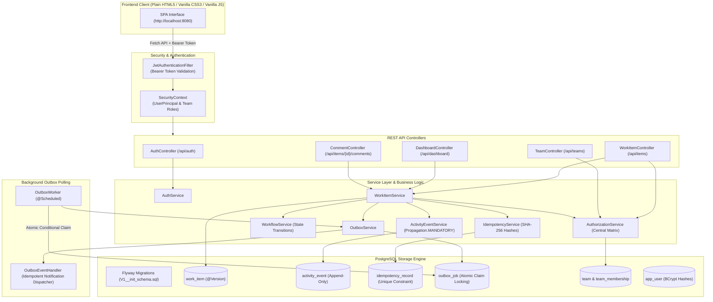

# Operations Under Pressure — Newtonite Software Engineering Challenge

> A production-minded, mission-critical operational management platform designed for high-contention enterprise environments. Handles operational work items, incident response, compliance approvals, and multi-team workflows with database-backed concurrency control, optimistic locking, idempotent creation, and a transactional outbox.

---

## 1. Project Overview & Architecture

**Operations Under Pressure** (`newtonite-ops`) provides an internal operations system allowing engineering, payment, risk, and customer support teams to create, assign, claim, track, discuss, and resolve mission-critical work items without race conditions, lost updates, or unauthorized cross-team access.

### Architecture Diagram



---

## 2. Technology Stack

- **Backend Runtime**: Java 21 LTS
- **Framework**: Spring Boot 3.4.3
- **Security**: Spring Security 6 with stateless signed HMAC-SHA256 JWT (`jjwt 0.12.6`) and BCrypt password hashing
- **Persistence**: Spring Data JPA / Hibernate ORM with optimistic locking (`@Version`)
- **Database**: PostgreSQL with Flyway database schema migrations
- **Observability**: Spring Boot Actuator (`/actuator/health`)
- **Frontend**: Plain HTML5, Plain CSS3 (custom responsive design system, no frameworks), Vanilla JavaScript (ES6+ Fetch API, safe DOM rendering via `textContent`)
- **Containerization**: Docker Compose (`docker-compose.yml`) for PostgreSQL

---

## 3. Demo Credentials & User Roles

The database is pre-seeded deterministically with 10 users across 4 teams:

| Username | Role | Primary Team Access | Password |
|---|---|---|---|
| `admin_alice` | **ADMIN** | Core Infrastructure, Payment Services | `Password123!` |
| `lead_bob` | **LEAD** | Core Infrastructure, Customer Support | `Password123!` |
| `member_charlie` | **MEMBER** | Core Infrastructure | `Password123!` |
| `viewer_diana` | **VIEWER** | Core Infrastructure | `Password123!` |
| `lead_elena` | **LEAD** | Payment Services | `Password123!` |
| `member_frank` | **MEMBER** | Payment Services | `Password123!` |
| `lead_grace` | **LEAD** | Compliance & Risk | `Password123!` |
| `member_harry` | **MEMBER** | Compliance & Risk | `Password123!` |
| `viewer_iris` | **VIEWER** | Compliance & Risk | `Password123!` |
| `member_jack` | **MEMBER** | Customer Support | `Password123!` |

---

## 4. Quick Start & Execution Guide

### Prerequisites
1. **Java 21 LTS** installed and on `PATH`
2. **Docker & Docker Compose** (or local PostgreSQL 14+)

### Step 1: Start PostgreSQL

Using Docker Compose:
```bash
docker compose up -d postgres
```

Verify PostgreSQL is running:
```bash
docker compose ps
```

### Step 2: Build the Application with Maven Wrapper

**Windows (PowerShell):**
```powershell
.\mvnw.cmd clean package
```

**Linux / macOS:**
```bash
./mvnw clean package
```

### Step 3: Run the Automated Test Suite

**Windows (PowerShell):**
```powershell
.\mvnw.cmd test
```

**Linux / macOS:**
```bash
./mvnw test
```

### Step 4: Launch the Spring Boot Application

**Windows (PowerShell):**
```powershell
.\mvnw.cmd spring-boot:run
```

**Linux / macOS:**
```bash
./mvnw spring-boot:run
```

### Step 5: Access the Web Dashboard

Open your browser at:
```
http://localhost:8080
```

---

## 5. Critical Engineering Highlights

### A. Atomic Concurrent Claim (`POST /api/items/{id}/claim`)
Guarantees that when multiple engineers click "Claim" on an unassigned item simultaneously, exactly one succeeds and competitors receive `409 Conflict`:
```java
@Modifying(clearAutomatically = true, flushAutomatically = true)
@Query("UPDATE WorkItem w SET w.assignee = :assignee, w.version = w.version + 1, w.updatedAt = :now " +
       "WHERE w.id = :id AND w.assignee IS NULL")
int claimAtomically(@Param("id") UUID id, @Param("assignee") User assignee, @Param("now") Instant now);
```

### B. Optimistic Locking & Stale Updates (`@Version`)
Every editable work item exposes a `version`. Mutating endpoints require the client to supply its known version. If a stale version is received, the backend rejects it with `HTTP 409 Conflict` and message:
> *"This item has changed since you opened it. Reload the latest version before editing."*

### C. Idempotent Create Requests (`Idempotency-Key`)
When the `Idempotency-Key` header is supplied on `POST /api/items`:
- Identical retries with matching payload replay the original response.
- Reusing a key with a conflicting payload is rejected with `HTTP 409 Conflict`.
- A database-level uniqueness constraint `(idempotency_key, actor_id, operation)` prevents duplicate records under simultaneous network retries.

### D. Resource-Level Team Authorization
- Centralized in `AuthorizationService.java`.
- Users cannot read or modify items from teams they do not belong to.
- Multi-team roles enforce fine-grained capabilities:
  - `VIEWER`: Read-only.
  - `MEMBER`: Create, claim unassigned, edit fields, add comments, move items through non-approval transitions.
  - `LEAD`: All member actions + assign/reassign tickets + approve tickets in `AWAITING_APPROVAL`.
  - `ADMIN`: Lead capabilities within teams where Admin role is held.

### E. Transactional Activity History
All audit entries are written to `activity_event` using `@Transactional(propagation = Propagation.MANDATORY)`. If the business update fails, the audit record is automatically rolled back.

### F. Reliable Asynchronous Outbox
- Persists domain events (`WORK_ITEM_CREATED`, `WORK_ITEM_ASSIGNED`, `WORK_ITEM_STATUS_CHANGED`) in `outbox_job` during the main business transaction.
- `OutboxWorker` polls due `PENDING` jobs, atomically claims them using `UPDATE ... WHERE status = 'PENDING'`, applies exponential backoff retry (`2^attempts * 2` seconds), and marks failed jobs `FAILED` after reaching the maximum attempt threshold.
- `OutboxEventHandler` is idempotent to prevent duplicate side effects upon retry.

---

## 6. REST API Endpoints Summary

| Method | Endpoint | Description | Auth Required |
|---|---|---|---|
| `POST` | `/api/auth/login` | Authenticate username/password & return JWT | No |
| `GET` | `/api/auth/me` | Current user profile & team memberships | Yes |
| `GET` | `/api/teams` | List teams accessible to current user | Yes |
| `GET` | `/api/teams/{id}/members` | List members of a specific team | Yes |
| `POST` | `/api/items` | Create work item (supports `Idempotency-Key`) | Yes (Member+) |
| `GET` | `/api/items` | Paginated search & filtering across authorized teams | Yes |
| `GET` | `/api/items/{id}` | Retrieve single work item details | Yes |
| `PATCH` | `/api/items/{id}` | Update title, priority, description, due date | Yes (Member+) |
| `POST` | `/api/items/{id}/claim` | Atomically claim an unassigned item | Yes (Member+) |
| `POST` | `/api/items/{id}/assign` | Assign/reassign item to team member | Yes (Lead+) |
| `POST` | `/api/items/{id}/transition` | Workflow transition (approval requires Lead) | Yes |
| `GET` | `/api/items/{id}/activity` | Paginated audit activity timeline | Yes |
| `GET` | `/api/items/{id}/comments` | List discussion comments | Yes |
| `POST` | `/api/items/{id}/comments` | Post comment to work item | Yes (Member+) |
| `GET` | `/api/dashboard/summary` | Team-scoped KPI counts & recent items | Yes |
| `GET` | `/api/dashboard/assigned-to-me`| Work items assigned to authenticated user | Yes |
| `GET` | `/api/dashboard/unassigned-urgent` | Urgent unassigned items in user's teams | Yes |
| `GET` | `/api/dashboard/awaiting-approval` | Items awaiting approval in teams user leads | Yes (Lead+) |
| `GET` | `/actuator/health` | Service health status check | No |

---

## 7. 3–5 Minute Live Demonstration Sequence

1. **Sign In as Member**:
   - Click quickfill `member_charlie` (password `Password123!`).
   - Notice the dashboard shows items scoped exclusively to *Core Infrastructure*.
2. **Claim an Incident**:
   - Navigate to *Unassigned Urgent*.
   - Click "Kubernetes ingress controller SSL certificate expiring".
   - Click **Claim Item**. Notice the assignee immediately updates to Charlie Member, version increments, and an audit entry appears in the Activity Timeline.
3. **Workflow Transition to Approval**:
   - Click **Move to In Progress**, then **Move to Awaiting Approval**.
   - Notice that Charlie (Member) cannot approve the item (the "Move to Resolved" button is hidden/forbidden).
4. **Sign Out and Log In as Lead**:
   - Sign out and click quickfill `lead_bob` (password `Password123!`).
   - Notice the KPI card shows **1 Item Awaiting Approval**.
   - Open the item, review Charlie's comments and timeline, and click **Move to Resolved** (approval succeeds).
5. **Cross-Team Security Demonstration**:
   - Notice Bob cannot see items belonging to *Compliance & Risk*.
   - Attempting an API request to an unauthorized team returns `403 Forbidden`.
6. **Optimistic Locking Demonstration**:
   - Open an item in two separate browser tabs.
   - Update the priority in Tab 1.
   - Try to update the title in Tab 2 without refreshing: Tab 2 receives `HTTP 409 Conflict` with the prompt: *"This item has changed since you opened it. Reload the latest version before editing."*
